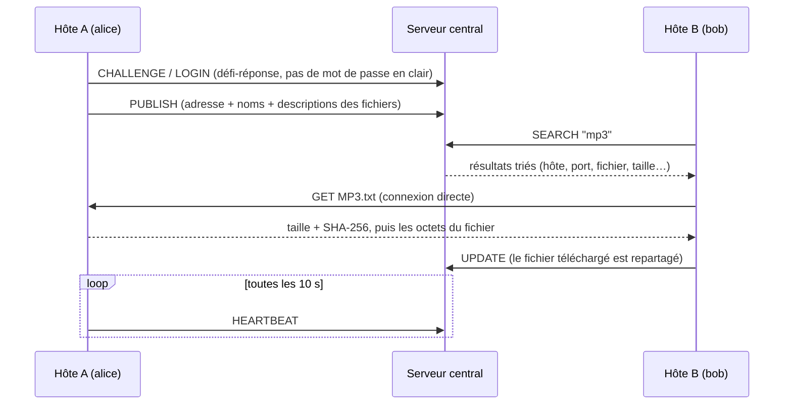

# Partage de fichiers P2P avec serveur central

Projet du module **Programmation IP** (M2 IRS, UVSQ / Université Paris-Saclay), en Python 3.12+, sans aucune dépendance externe.

Un **serveur central** authentifie les utilisateurs, indexe les descriptions des fichiers partagés et répond aux recherches par mot-clé. Chaque **hôte** fait tourner un serveur de fichiers et un client : les fichiers passent **directement d'un hôte à l'autre**, jamais par le central (modèle P2P hybride, comme Napster).



## Fonctionnalités

| Exigence du sujet | Implémentation |
|---|---|
| Serveur central + client et serveur de fichiers par hôte | `central.py`, `peer.py` |
| Enregistrement et authentification façon `crypt()`, mot de passe jamais en clair | sel + PBKDF2-SHA256 stockés ; connexion par défi-réponse HMAC (nonce à usage unique) |
| Publication du hostname, des noms et descriptions des fichiers | `descriptions.json` dans le dossier partagé |
| Sous-répertoires *(amélioré)* | parcours récursif, chemins relatifs |
| Recherche par mot-clé, **même en sous-chaîne** *(amélioré)* | insensible à la casse et aux accents |
| Tri côté serveur **et** côté client | serveur : pertinence ; client : `sort name/size/host/date` sans nouvelle requête |
| Téléchargement direct, download uniquement | le serveur de fichiers ne connaît que `GET` |
| Fichier téléchargé repartagé + mise à jour du central | `UPDATE` automatique après vérification SHA-256 |
| Déconnexion annoncée | `LOGOUT` à `quit` ou Ctrl+C |
| Heartbeat, déconnexion déduite *(amélioré)* | heartbeat toutes les 10 s, hôte retiré après 30 s de silence |
| Plusieurs hôtes en même temps | serveurs multi-threads, état partagé protégé par un verrou |

**Choix techniques** : TCP (un fichier doit arriver complet et dans l'ordre), un thread par connexion (`socketserver.ThreadingTCPServer`), messages JSON d'une ligne, fichiers en octets bruts précédés de leur taille. Détail : [docs/protocole.md](docs/protocole.md).

## Lancer une démonstration (une seule machine)

Prérequis : Python 3.12 ou plus. Chaque commande dans une fenêtre de terminal, depuis la racine du projet.

```bash
python central.py                                                                       # 1. serveur central (port 5000)
python peer.py --central-host 127.0.0.1 --shared demo/alice --port 6001 --register      # 2. hôte alice
python peer.py --central-host 127.0.0.1 --shared demo/bob   --port 6002 --register      # 3. hôte bob
python peer.py --central-host 127.0.0.1 --shared demo/carol --port 6003 --register      # 4. hôte carol
```

Sous Windows, remplacer `python` par `py`. `--register` crée le compte au premier lancement ; ensuite, l'enlever.

Sur plusieurs machines : lancer `central.py` sur l'une d'elles, et donner à **tous** les hôtes son adresse IP réelle (`--central-host 192.168.x.y`), jamais `127.0.0.1`. Ouvrir les ports TCP 5000 et 6001+ dans le pare-feu.

### Options

| Programme | Option | Rôle |
|---|---|---|
| `central.py` | `--host`, `--port` | adresse et port d'écoute (défaut `0.0.0.0:5000`) |
| | `--users` | fichier des comptes (défaut `users.json`) |
| | `-v` | affiche aussi chaque connexion TCP |
| `peer.py` | `--central-host`, `--central-port` | adresse du serveur central |
| | `--shared` | dossier des fichiers partagés |
| | `--port` | port du serveur de fichiers local (défaut 6001) |
| | `--host` | adresse annoncée aux autres hôtes (défaut : celle vue par le central) |
| | `--register` | crée le compte avant de se connecter |

### Commandes du client

| Commande | Effet |
|---|---|
| `search <mot-clé> [tri]` | recherche ; tri : `relevance` (défaut), `name`, `size`, `host`, `date` |
| `sort <critère>` | retrie les derniers résultats localement |
| `get <n°>` | télécharge le fichier n° depuis l'hôte qui le partage |
| `list` | réaffiche les derniers résultats |
| `help`, `quit` | aide, déconnexion propre |

### Exemple de session (hôte carol)

```
p2p:carol> search mp3
 n°  fichier                         taille  date        hôte                   description
  1  MP3.txt                          128 o  2026-11-20  alice@127.0.0.1:6001   FAQ sur l'algorithme de compression utilisé dans l
  2  musique/playlist.txt              58 o  2026-11-20  bob@127.0.0.1:6002     Playlist de musique au format MP3
p2p:carol> get 1
Téléchargement de MP3.txt depuis alice@127.0.0.1:6001
  [#########################] 100 %  128 o
OK : demo/carol/MP3.txt (SHA-256 vérifié)
Fichier ajouté à tes partages et liste mise à jour auprès du central.
```

## Description des fichiers partagés

Chaque dossier partagé contient un `descriptions.json` ; les champs autres que `desc` sont facultatifs :

```json
{
  "MP3.txt": {"desc": "FAQ sur l'algorithme de compression utilisé dans le codage audio MPEG-2", "author": "Alice"},
  "cours/tcp.txt": {"desc": "Cours sur le protocole TCP"}
}
```

Un fichier sans description est quand même partagé (recherche sur son nom). Taille, date et empreinte SHA-256 sont calculées automatiquement.

## Sécurité

- **Mot de passe** : jamais envoyé ni stocké. Le central garde `(sel, PBKDF2(mot de passe, sel))`. À la connexion, il envoie un nonce aléatoire ; le client répond `HMAC(hash, nonce)`. Une réponse capturée ne peut pas être rejouée. Preuve Wireshark : [docs/03-authentification.md](docs/03-authentification.md).
- **Fichiers servis** : uniquement ceux publiés, et jamais hors du dossier partagé (protection contre `../../`).
- **Intégrité** : téléchargement dans un `.part`, comparaison du SHA-256 avec l'empreinte publiée, puis renommage. Un fichier corrompu n'est jamais repartagé.
- **Entrées réseau** : chaque message est validé (types, tailles, nombre de fichiers) ; une ligne ne peut pas dépasser 1 Mio.

## Structure

```
central.py              serveur central (auth, index, recherche, heartbeat)
peer.py                 hôte : serveur de fichiers + client interactif
p2p/
  protocol.py           messages JSON et fichiers sur TCP (découpage du flux)
  auth.py               sel, PBKDF2, défi-réponse HMAC
  central_client.py     requêtes de l'hôte vers le central, heartbeat
  shared.py             dossier partagé et descriptions.json
  index.py              recherche par mot-clé et tri
  file_server.py        serveur de fichiers (GET uniquement)
  client.py             shell interactif, téléchargement
tests/                  55 tests unitaires et d'intégration
demo/                   dossiers partagés d'exemple (alice, bob, carol)
docs/                   protocole et preuve Wireshark
```

## Tests

```bash
python -m unittest -v
```

55 tests : découpage des messages TCP, authentification (rejeu, stockage, concurrence), publication, recherche et tri, transfert (gros fichier binaire, path traversal, empreinte fausse), repartage, heartbeat et déconnexion, charge (20 hôtes simultanés, 1 000 fichiers).

`demo/carol/image.bin` (2 Mo, pour tester les gros transferts) n'est pas versionné ; pour le recréer :
`python -c "import os; open('demo/carol/image.bin','wb').write(os.urandom(2*1024*1024))"`

## Limites et améliorations possibles

- Les transferts et messages ne sont pas chiffrés (TLS possible avec le module `ssl`) : l'authentification est protégée, pas le contenu.
- Le central est un point unique de défaillance et garde l'index en mémoire : s'il redémarre, les hôtes doivent se relancer.
- Un fichier est téléchargé depuis une seule source ; on pourrait le découper et télécharger les morceaux depuis plusieurs pairs (comme BitTorrent).
- La recherche parcourt tous les fichiers (O(n)) ; un index inversé serait nécessaire à grande échelle.
