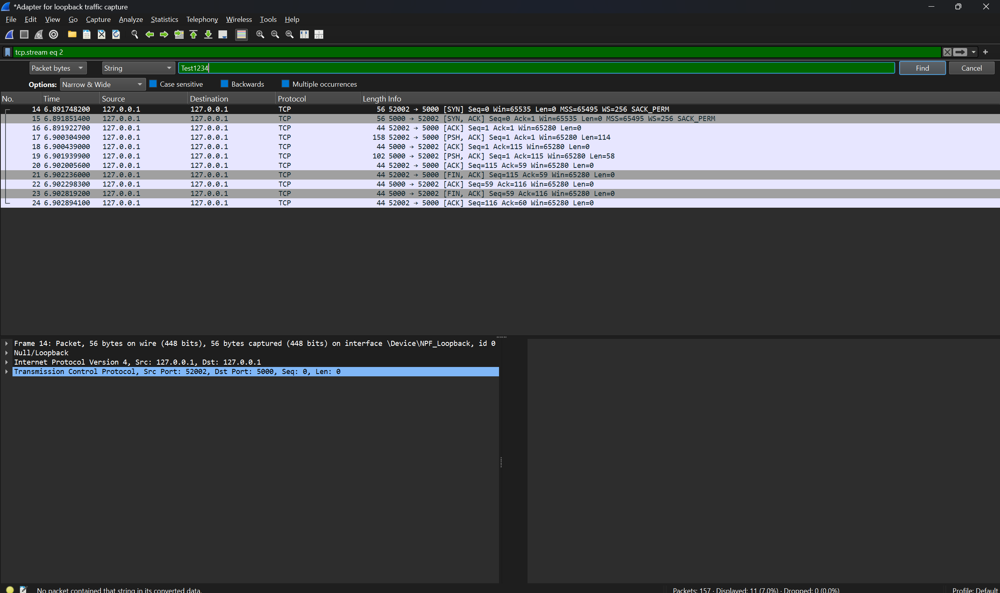

# Phase 3 : Enregistrement et authentification

## Objectif
Authentifier les utilisateurs sans jamais envoyer le mot de passe en clair sur le réseau (exigence du sujet).

## Principe
- **Enregistrement** : le client génère un sel aléatoire et calcule `hash = PBKDF2-SHA256(mot de passe, sel, 200 000 itérations)`. Il envoie seulement `(sel, hash)`. Le central les stocke dans `users.json`, comme `/etc/shadow` avec `crypt()`.
- **Connexion (défi-réponse)** :
  1. `CHALLENGE` : le central renvoie le sel de l'utilisateur et un **nonce** aléatoire, valable 30 s et à usage unique.
  2. Le client recalcule le hash et envoie `proof = HMAC-SHA256(hash, nonce)`.
  3. Le central recalcule la preuve, compare en temps constant et renvoie un **token** de session.

Le nonce change à chaque connexion : une preuve capturée ne peut pas être rejouée.

## Preuve : capture Wireshark
Interface loopback, filtre `tcp.port == 5000`, login de l'utilisateur `slimane` (mot de passe `Test1234`).

**Défi** : le central envoie le sel et le nonce.

**Réponse** : le client envoie une preuve HMAC et reçoit un token.

**Recherche de `Test1234` dans tous les octets capturés** : aucun paquet ne la contient.

## Tests automatisés (`tests/test_central.py`, classe `TestAuth`)
| Test | Vérifie |
|---|---|
| `test_rejeu_impossible` | une preuve capturée et renvoyée est refusée |
| `test_mot_de_passe_jamais_stocke` | `users.json` ne contient que `salt` et `hash` |
| `test_meme_mot_de_passe_hash_differents` | le sel rend les hash uniques |
| `test_enregistrements_simultanes` | 10 enregistrements en parallèle, aucune perte (verrou) |

## Pourquoi pas le module `crypt` ?
Il a été supprimé de Python 3.13 (PEP 594). PBKDF2 (`hashlib.pbkdf2_hmac`) applique le même principe, sel + fonction lente, avec un algorithme moderne.